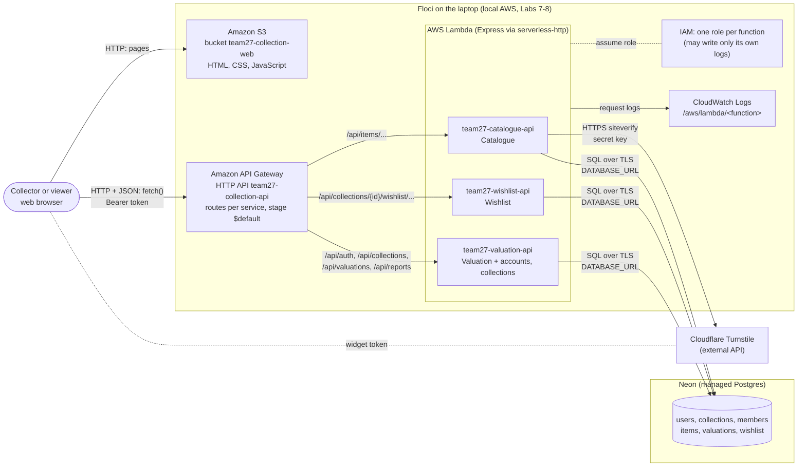
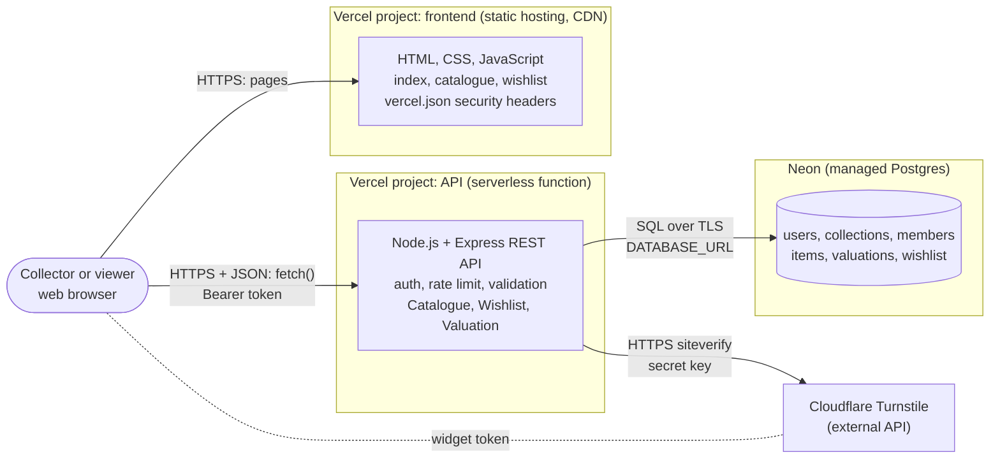
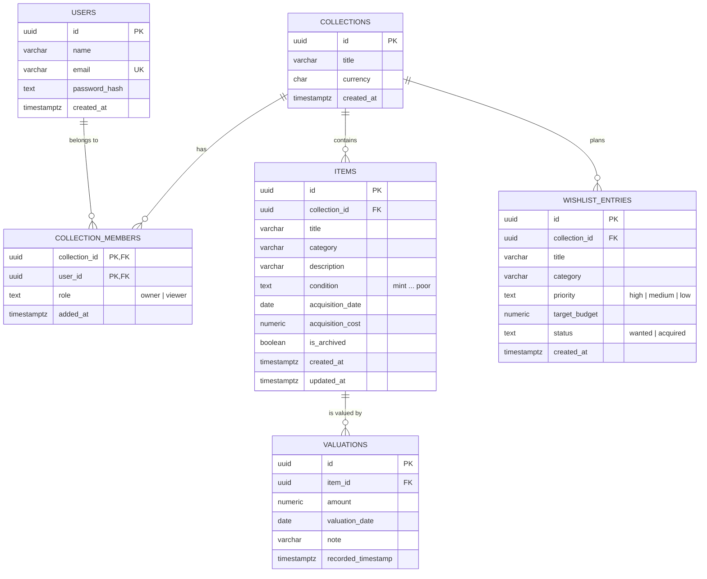
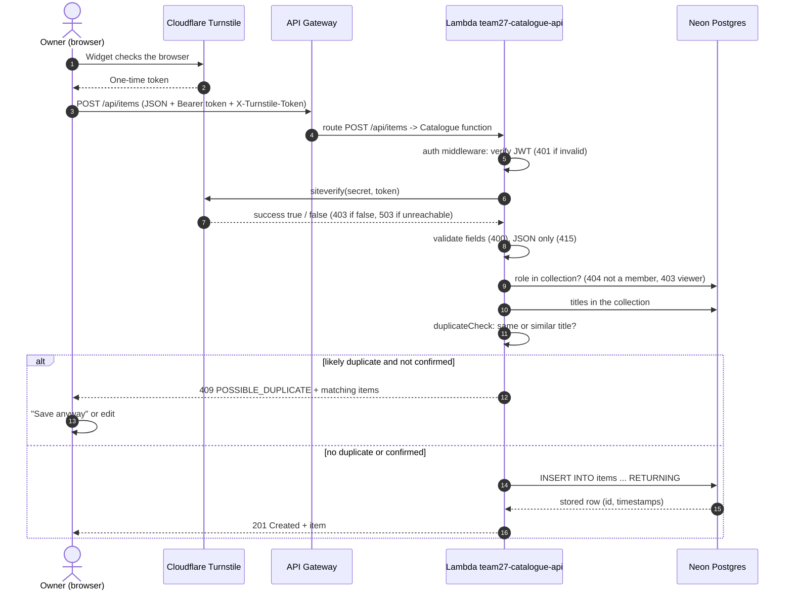

# Collection Manager: architecture

GitHub draws the diagrams below automatically (Mermaid).

## 1. Three-layer cloud architecture (Floci, main deployment)



| Layer | Responsibility | Cloud service (Floci) | Talks to |
|---|---|---|---|
| Presentation | Forms, lists, loading and error messages; no secrets | Amazon S3 (static website) | API Gateway over HTTP/JSON; Turnstile widget |
| Application | Login check, role check, validation, business rules, duplicate matching, summaries | API Gateway (HTTP API) + one AWS Lambda function per service, IAM roles, CloudWatch Logs | Neon over TLS; Cloudflare siteverify over HTTPS |
| Data | Persistent records with relationships and `CHECK` rules | Neon Postgres | Reached only through the Lambda functions |

Cloud model: **public cloud services (AWS, emulated locally by Floci)** used as
**serverless / Function as a Service**: API Gateway and Lambda run the code only when a
request arrives and scale by running more copies, so there are no servers to manage.
S3 hosts the static files, IAM limits what each function may do, and CloudWatch collects
the logs. The database is **Neon, a managed PaaS database**: our data has relationships
(members, items, valuations) and `CHECK` rules, which a relational database handles better
than DynamoDB. **Turnstile is consumed as SaaS.** Nothing is stored on the functions'
temporary file system; all state is in Neon.

Each service is deployed as its own function, so it can be updated, monitored (its own log
group) and limited (its own IAM role) separately, while all three share one database and
one API address.

### Also deployed: Vercel + Neon (public copy)



## 2. Database (entity relationship)



Items are archived rather than deleted, so their valuation history is kept. Archived items
are hidden by default and excluded from the collection value.

## 3. Request flow: creating a catalogue item



## 4. Trust boundary

```
USER-CONTROLLED SIDE                    APPLICATION-CONTROLLED SIDE
Browser: forms, config.js (public)  --HTTP(S)-->  API Gateway -> Lambda  --TLS-->  Neon
          Turnstile widget                      secrets in env vars:
                                                DATABASE_URL, JWT_SECRET,
                                                TURNSTILE_SECRET_KEY
```

1. The API validates every request; browser checks are only for convenience.
2. The browser never reaches the database; only the Lambda functions have `DATABASE_URL`,
   and only the Catalogue function has the Turnstile secret key.
3. Roles are decided on the server from `collection_members`, never from what the browser sends.
4. Data is shown with `textContent`, never `innerHTML`, and the Content-Security-Policy only
   allows the site's own scripts and Cloudflare's widget.
5. Errors return generic messages; details go only to the server logs (CloudWatch Logs
   on Floci, the Logs tab on Vercel).
