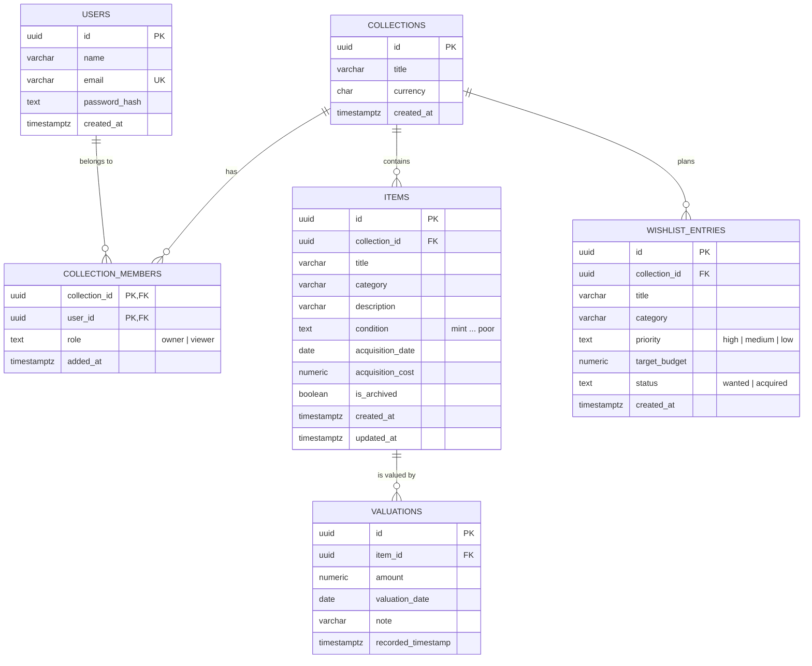
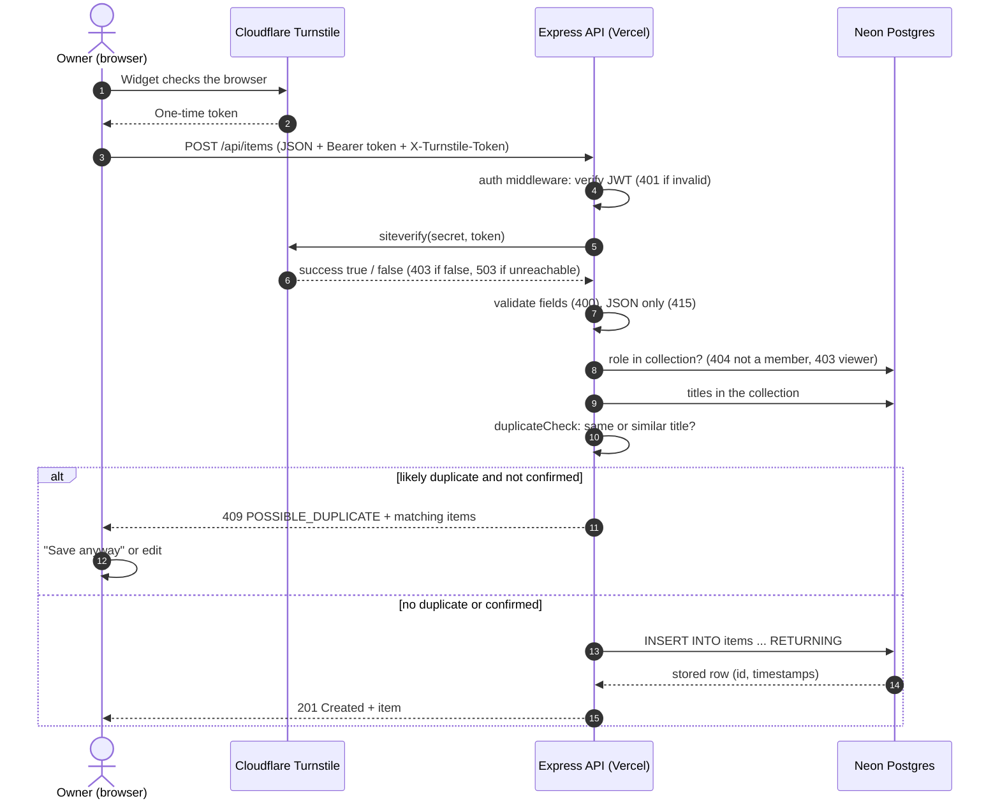

# Collection Manager: architecture

GitHub draws the diagrams below automatically (Mermaid).

## 1. Three-layer cloud architecture


| Layer | Responsibility | Cloud service | Talks to |
|---|---|---|---|
| Presentation | Forms, lists, loading and error messages; no secrets | Vercel static hosting | API over HTTPS/JSON; Turnstile widget |
| Application | Login check, role check, validation, business rules, duplicate matching, summaries | Vercel Function (Express) | Neon over TLS; Cloudflare siteverify over HTTPS |
| Data | Persistent records with relationships and `CHECK` rules | Neon Postgres | Reached only through the API |

Cloud model: **public cloud, PaaS** (Vercel runs the code, Neon runs the database) with
**serverless compute** (the API runs on demand and scales automatically) and
**Turnstile consumed as SaaS**. Nothing is stored on the function's temporary file system;
all state is in Neon.

## 2. Database (entity relationship)



Items are archived rather than deleted, so their valuation history is kept. Archived items
are hidden by default and excluded from the collection value.

## 3. Request flow: creating a catalogue item



## 4. Trust boundary

```
USER-CONTROLLED SIDE                    APPLICATION-CONTROLLED SIDE
Browser: forms, config.js (public)  --HTTPS-->  Express API  --TLS-->  Neon
          Turnstile widget                      secrets in env vars:
                                                DATABASE_URL, JWT_SECRET,
                                                TURNSTILE_SECRET_KEY
```

1. The API validates every request; browser checks are only for convenience.
2. The browser never reaches the database; only the API has `DATABASE_URL`.
3. Roles are decided on the server from `collection_members`, never from what the browser sends.
4. Data is shown with `textContent`, never `innerHTML`, and the Content-Security-Policy only
   allows the site's own scripts and Cloudflare's widget.
5. Errors return generic messages; details go only to the server logs (Vercel Logs).
